# Gym Membership Management System (MongoDB)

Database Systems Project (BCSE302L), VIT Vellore, Fall Semester 2026-27
**Team:** Liz Alex (24BCE2978), Malika Balaji (24BAI0114), Nehaa Prabhu (24BAI0130)
**Faculty:** Prof. Lydia Jane G

A MongoDB database for a gym: members, trainers, workout plans, classes, sessions, attendance and payments,
with integrity rules, analytical reports, ACID transactions and change-stream triggers.

## Reports

| Stage | Scope | Documents |
|---|---|---|
| **Final report** | Full database life cycle: requirements, EER, 3NF, document model, implementation, query set, performance tuning, results | [Final Report (PDF)](docs/Final/Final_Report.pdf), [Word version](docs/Final/Final_Report.docx) |
| Review 2 | Database implementation, CRUD, advanced NoSQL features | [Review 2 Report (PDF)](docs/Review2/Review2_Report.pdf), [Word version](docs/Review2/Review2_Report.docx) |
| Review 1 | Problem statement, requirements, NoSQL selection, data model | [Review 1 Report (PDF)](docs/Review1/Review1_Report.pdf) |

## Results at a glance

| Area | Result |
|---|---|
| Database | 7 collections with `$jsonSchema` validators, 19 indexes, 1 view, 1,016 sample documents |
| CRUD | 36 functions with 10 referential integrity rules |
| Query set | 15 queries: selection, joins (inner, three-way, left outer), grouping with HAVING, scalar, correlated and EXISTS subqueries, UNION, INTERSECT, EXCEPT |
| Reports | 8 aggregation pipelines and a recursive `$graphLookup` referral network |
| Performance | Member history query 80.46 ms to 2.10 ms with `ix_member_date` at 200,000 documents; partial index 10 times smaller than a full index |
| Consistency | 2 ACID transactions (commit and rollback verified), 2 change-stream triggers |
| Tests | 6 automated tests pass |

Every output in the reports comes from a live MongoDB 8.3 replica set:
[`demo_output.txt`](demo_output.txt), [`query_output.txt`](query_output.txt), [`benchmark_output.txt`](benchmark_output.txt).

## Repository structure

| Path | Purpose |
|---|---|
| `gym_db/config.py` | Connection settings, reference date, tier fees |
| `gym_db/schema.py` | Creates the 7 collections with `$jsonSchema` validators |
| `gym_db/indexes.py` | 19 indexes (unique, compound, multikey, text, partial) and the `explain()` comparison |
| `gym_db/seed.py` | Loads 1,016 reproducible sample documents |
| `gym_db/crud.py` | Create, read, update, delete for every collection, with integrity rules |
| `gym_db/aggregations.py` | Reports A1 to A8, `$graphLookup` G1 and G2, `member_dashboard` view |
| `gym_db/transactions.py` | ACID transactions T1 (renew membership) and T2 (close a session) |
| `gym_db/triggers.py` | Change-stream triggers TR1 (audit trail) and TR2 (reactivate on payment) |
| `demo.py` | End-to-end demonstration in 7 sections |
| `queries.py` | Query set Q1 to Q15 with SQL equivalents |
| `benchmark.py` | Index benchmark at 200,000 documents |
| `export_data.py` | Exports the dataset to `data/*.json` |
| `mongosh/ddl.js` | Complete DDL: collections, validators, indexes, view |
| `mongosh/queries.js` | Query set for mongosh |
| `mongosh/demo_queries.js` | Demonstration highlights for mongosh |
| `data/*.json` | Sample data (Extended JSON, for `mongoimport`) |
| `tests/test_gym_db.py` | 6 automated tests |
| `docs/` | Review 1, Review 2 and final reports, diagrams, screenshots |

## How to run

### 1. Start MongoDB as a replica set (needed for transactions and triggers)

**macOS (Homebrew)**
```bash
brew tap mongodb/brew && brew trust mongodb/brew && brew install mongodb-community
# add to /opt/homebrew/etc/mongod.conf:
#   replication:
#     replSetName: rs0
brew services restart mongodb-community
mongosh --eval "rs.initiate()"
```

**Docker (any OS)**
```bash
docker run -d --name gymdb -p 27017:27017 mongo:8 --replSet rs0
docker exec gymdb mongosh --eval "rs.initiate()"
```

### 2. Install and run
```bash
python3 -m venv .venv
source .venv/bin/activate          # Windows: .venv\Scripts\activate
pip install -r requirements.txt

python demo.py                     # full demonstration (recreates gym_db)
python demo.py --section crud      # setup + one section: crud | agg | graph | index | txn | trig
python demo.py --section setup     # setup only
python queries.py                  # the 15 representative queries
python queries.py --only Q11       # one query
python benchmark.py                # index benchmark (about 10 seconds)
python -m pytest -q                # automated tests (no server needed)
python demo.py --mock              # demonstration without a server (in memory)
mongosh "mongodb://localhost:27017/?directConnection=true" mongosh/queries.js
```

All reports use a fixed reference date of 24 September 2026 (`gym_db/config.py`) so results are reproducible.
Test logins: `priya.menon@gym.com` / `Trainer@01`; members use `Member@<number>`, for example `Member@1001`.

## Sample data

| Collection | Documents |
|---|---:|
| trainers | 8 |
| members | 60 |
| workout_plans | 76 |
| classes | 8 |
| class_sessions | 64 |
| attendance | 580 |
| payments | 220 |
| **Total** | **1,016** |

## Design

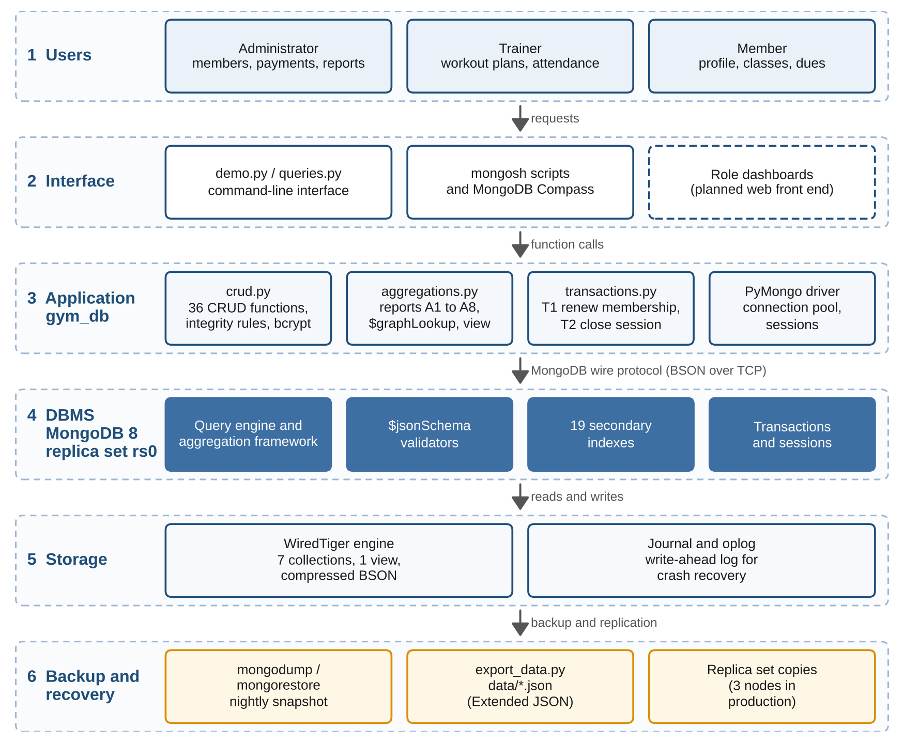

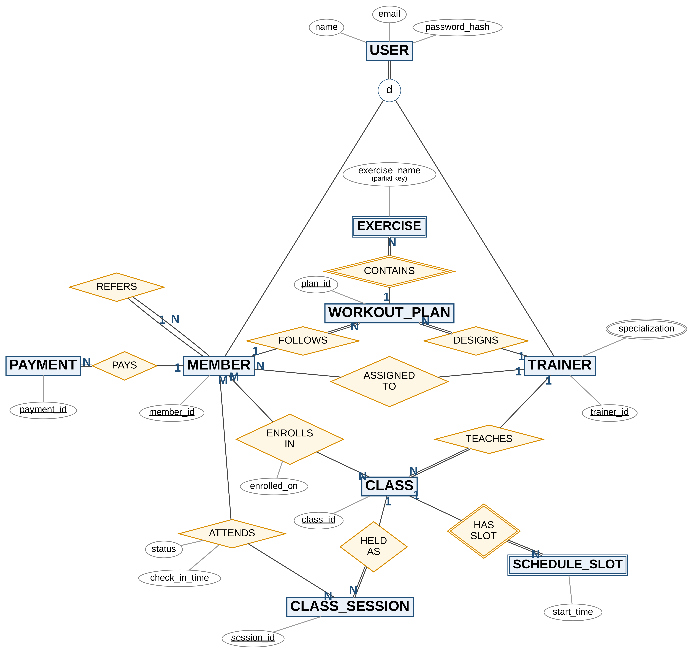

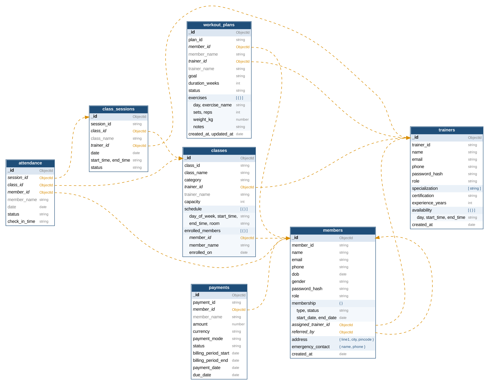

More diagrams (DFDs, full EER, 3NF relational schema) are in [`docs/Final/diagrams`](docs/Final/diagrams).

## Screenshots (live MongoDB runs)

**Validator rejecting invalid data**
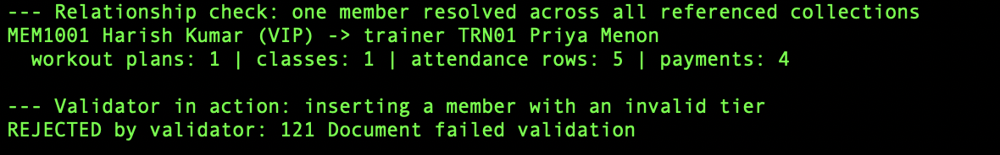

**CRUD operations**
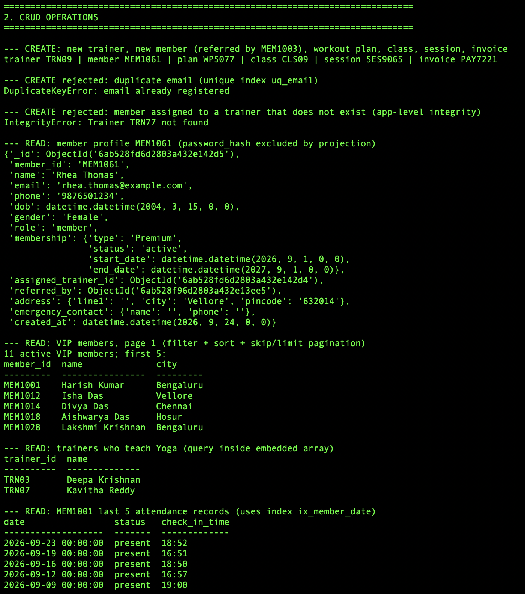
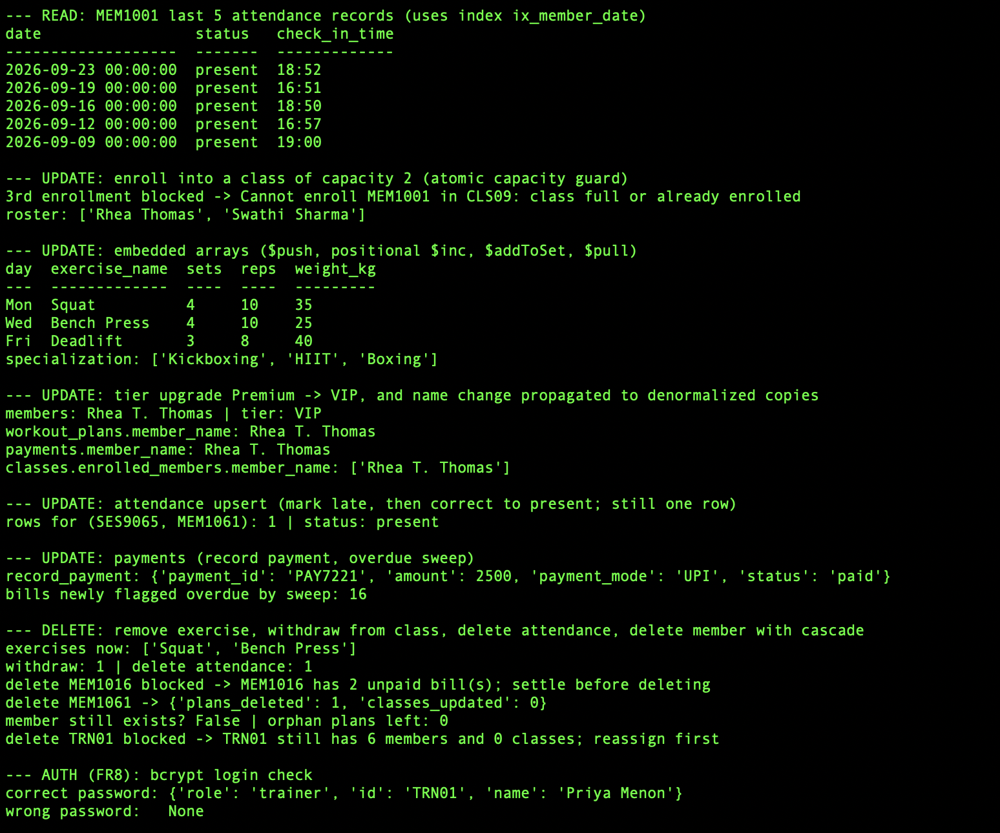

**Aggregation pipelines**
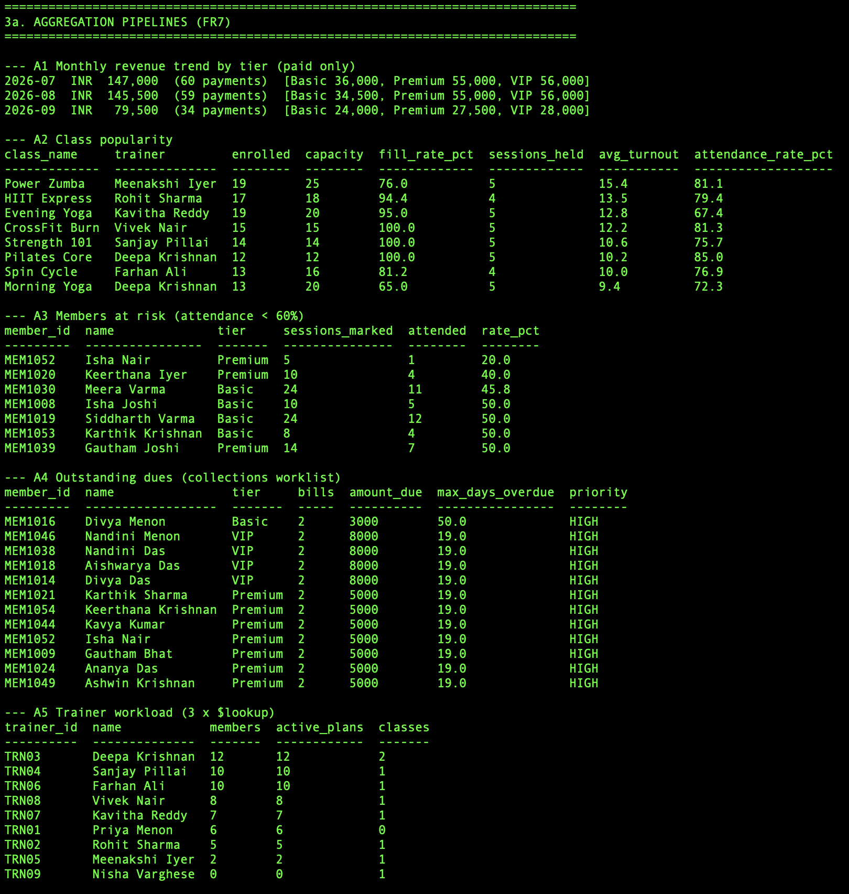

**Indexing and explain()**
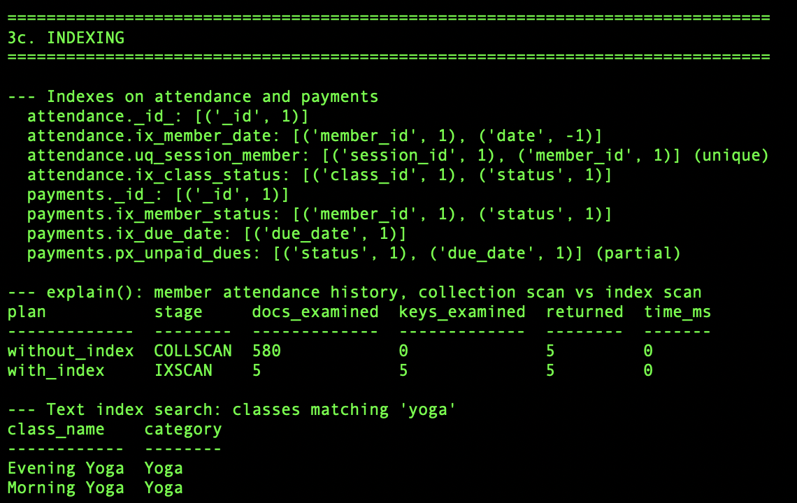

**ACID transactions**
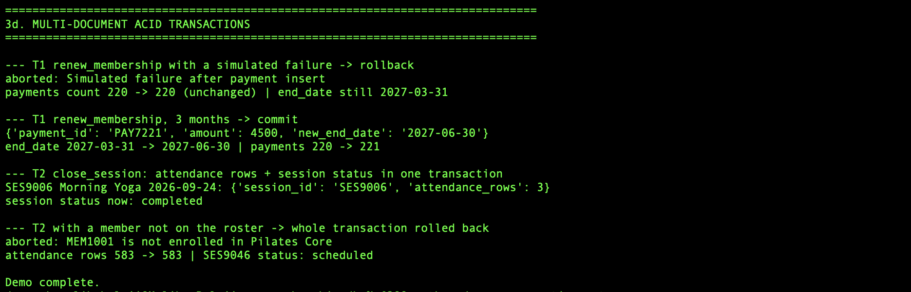

**Set operations, benchmark and triggers**
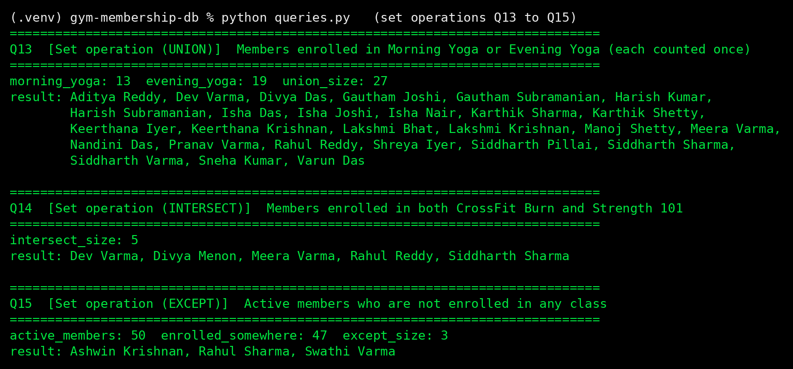
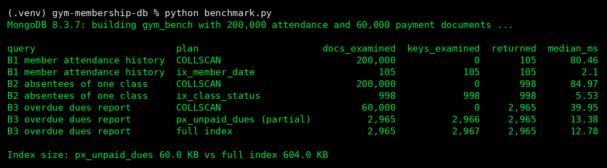
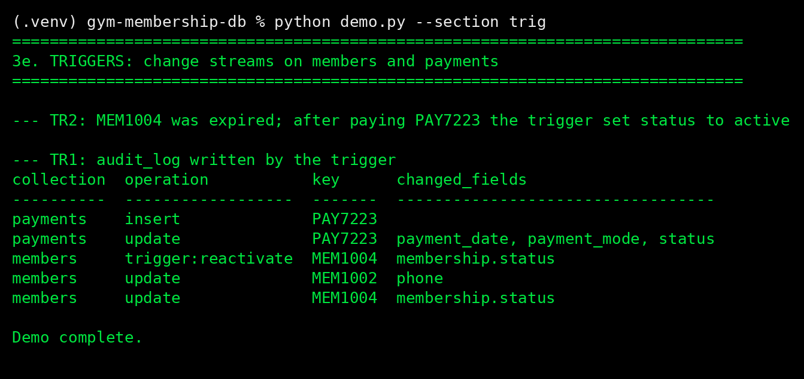
