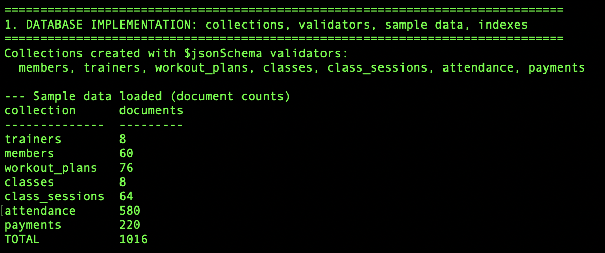
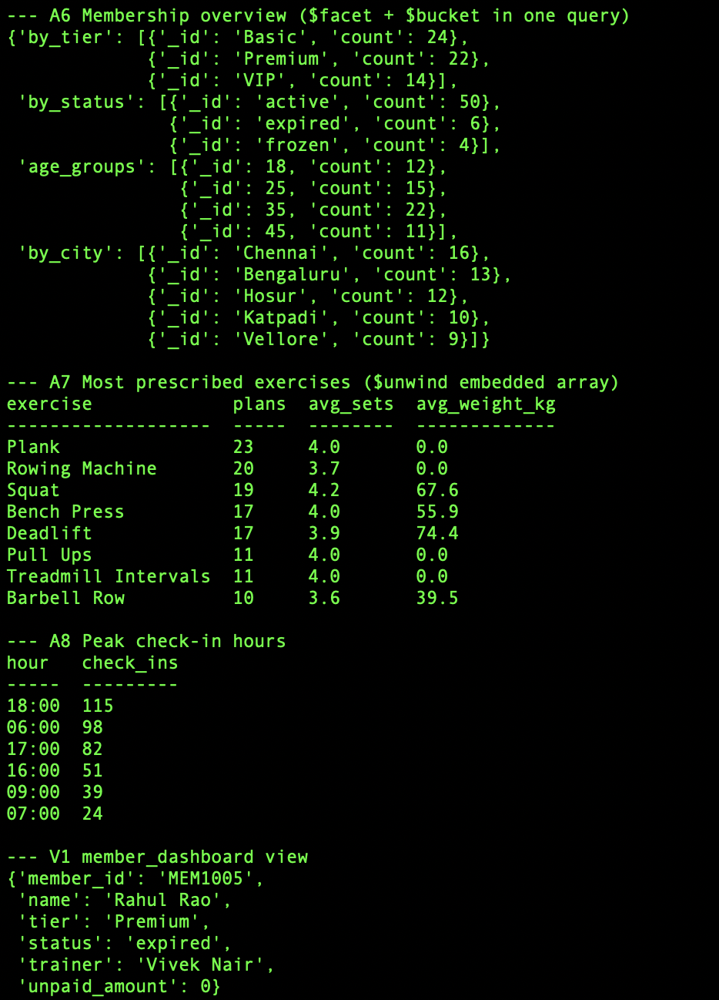
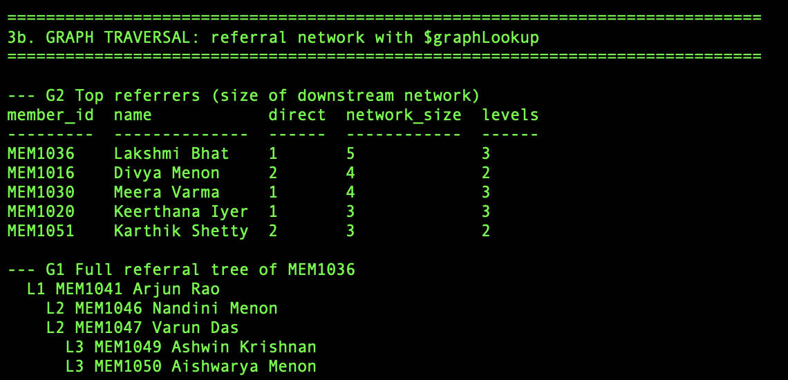

# Gym Membership Management System (MongoDB)

Database Systems Project, VIT Vellore
**Team:** Liz Alex (24BCE2978), Malika Balaji (24BAI0114), Nehaa Prabhu (24BAI0130)
**Faculty:** Prof. Lydia Jane G

A MongoDB-based system to manage gym members, trainers, workout plans, classes, attendance and payments,
with analytical reports built on the aggregation framework.

## Project reviews

| Review | Scope | Documents |
|---|---|---|
| Review 1 | Problem statement, requirements, NoSQL selection, data model | [Review 1 Report (PDF)](docs/Review1/Review1_Report.pdf) |
| Review 2 | Database implementation, CRUD, advanced NoSQL features | [Review 2 Report (PDF)](docs/Review2/Review2_Report.pdf), [Word version](docs/Review2/Review2_Report.docx) |

## Review 2 at a glance

| Rubric item | Delivered |
|---|---|
| Database implementation (2) | 7 collections with `$jsonSchema` validators, 10 relationships, 1,016 sample documents |
| CRUD operations (3) | 36 functions across all collections, 10 referential-integrity rules |
| Advanced NoSQL features (5) | 8 aggregation pipelines and a view, `$graphLookup` referral network, 19 indexes with `explain()` proof, 2 ACID transactions with rollback |

Verified on a live MongoDB 8.3 replica set. Full output: [`demo_output.txt`](demo_output.txt).

## Repository structure

| Path | Purpose |
|---|---|
| `gym_db/schema.py` | Creates the 7 collections with `$jsonSchema` validators |
| `gym_db/seed.py` | Loads 1,016 reproducible sample documents |
| `gym_db/indexes.py` | 19 indexes (unique, compound, multikey, text, partial) and the `explain()` comparison |
| `gym_db/crud.py` | Create, read, update, delete for every collection, with integrity rules |
| `gym_db/aggregations.py` | 8 aggregation pipelines, 2 `$graphLookup` traversals, 1 view |
| `gym_db/transactions.py` | 2 multi-document ACID transactions |
| `demo.py` | Runs the full demonstration in rubric order |
| `mongosh/demo_queries.js` | The same highlights as raw shell queries |
| `data/*.json` | Exported sample data (Extended JSON, for `mongoimport`) |
| `tests/test_gym_db.py` | 6 automated tests |
| `docs/` | Review 1 and Review 2 reports, rubric and screenshots |

## How to run

### 1. Start MongoDB as a replica set (needed for transactions)

**macOS (Homebrew)**
```bash
brew tap mongodb/brew && brew trust mongodb/brew && brew install mongodb-community
# add to /opt/homebrew/etc/mongod.conf:
#   replication:
#     replSetName: rs0
brew services restart mongodb-community
mongosh --eval "rs.initiate()"
```

**Docker (any OS)**
```bash
docker run -d --name gymdb -p 27017:27017 mongo:8 --replSet rs0
docker exec gymdb mongosh --eval "rs.initiate()"
```

### 2. Install and run
```bash
python3 -m venv .venv
source .venv/bin/activate          # Windows: .venv\Scripts\activate
pip install -r requirements.txt

python demo.py                     # full demonstration (recreates gym_db)
python demo.py --section index     # setup + one section: crud | agg | graph | index | txn
python demo.py --mock              # runs without a server (in-memory)
python -m pytest -q                # automated tests
mongosh "mongodb://localhost:27017/?directConnection=true" mongosh/demo_queries.js
```

All reports use a fixed reference date of 24 September 2026 (`gym_db/config.py`) so results are reproducible.
Test logins: `priya.menon@gym.com` / `Trainer@01`; members use `Member@<number>`, e.g. `Member@1001`.

## Sample data

| Collection | Documents |
|---|---:|
| trainers | 8 |
| members | 60 |
| workout_plans | 76 |
| classes | 8 |
| class_sessions | 64 |
| attendance | 580 |
| payments | 220 |
| **Total** | **1,016** |

## Screenshots (live MongoDB run)

**Validator rejecting invalid data**


**Sample data loaded**


**CRUD operations**


**Aggregation pipelines**



**Graph traversal ($graphLookup)**


**Indexing and explain()**


**ACID transactions**


## Change from Review 1

One field was added to `members`: `referred_by` (the referring member's ObjectId, or null). It models the gym's referral
programme as a self-referencing graph, used by the `$graphLookup` traversal.
